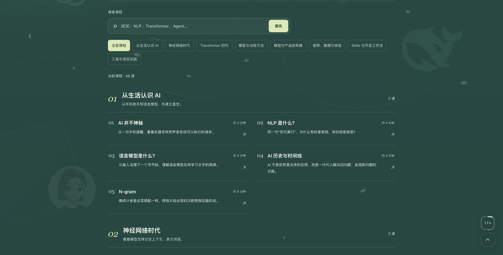
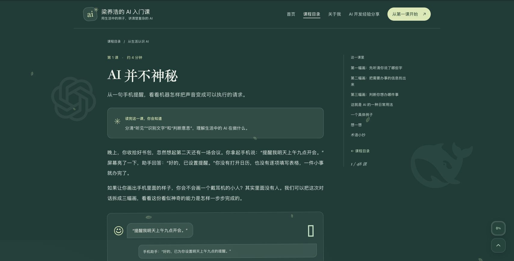
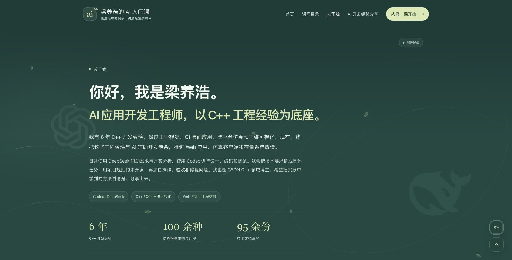
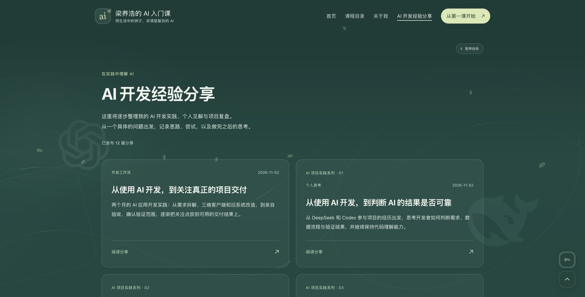
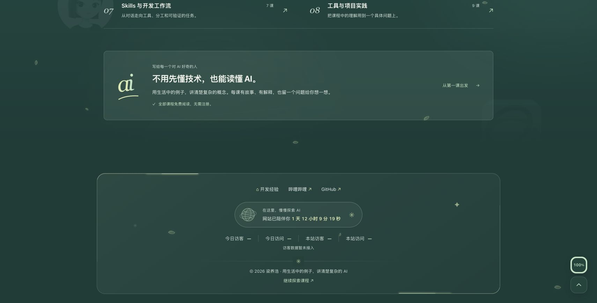

# 梁养浩的 AI 入门课

用生活中的例子，讲清楚复杂的 AI。网站包含 AI 入门课程、个人介绍，以及 AI 应用开发中的实践与思考。

线上网站：[liangyanghao.cn](https://liangyanghao.cn/) · 作者：[梁养浩 / liangyue520](https://github.com/liangyue520)

这是从当前开发工程整理的独立源码快照，包含最新本地预览中的改动，可能比线上版本更新。网站内容、样式、视频、图标及下载资源均随源码保留；原工程的数据库、账号、会话、环境配置和历史发布包不在此副本内。

## 网站内容

- 首页：玻璃质感卡片、绿色背景、动态线条、按钮与页脚流光。
- 课程目录与课程正文：48 节 AI 入门课程、阅读控制和课程导航。
- 关于我：个人经历、项目介绍、社交平台入口与 AI 技能下载。
- AI 开发经验分享：文章列表与独立详情页。
- 后台：登录、内容管理、导出和访问统计；保留原工程的服务端能力。部分早期个人内容栏目的公共入口当前隐藏。
- 页脚：网站运行时间、公开访问汇总及相关链接。

## 界面预览

以下为本仓库源码在本地构建后的实际页面截图。静态截图展示布局与配色，背景、线条和流光动画可在运行网站后体验。截图与全部界面图片均随仓库保存，无需访问外部图床。

### 首页


### 课程目录



### 课程正文



### 关于我



### AI 开发经验分享



### 页脚



## 技术栈

Vue 3、Vue Router、TypeScript、Vite；Node.js、Fastify、SQLite（Node 内置 `node:sqlite`）。依赖版本由 `package-lock.json` 固定。

## 本地运行

需要 **Node.js 24.20 或更高的 24.x 版本（不含 25）**。`.nvmrc` 使用 24.22.0；请使用匹配的 Node 版本安装依赖。

```sh
npm ci
cp .env.example .env.local
npm run dev -- --env dev
```

Windows 可使用 `Copy-Item .env.example .env.local` 复制配置。

- 前台：<http://127.0.0.1:5173/>
- API 健康检查：<http://127.0.0.1:3100/api/v1/health>
- 后台登录：<http://127.0.0.1:5173/admin/login>

请从本项目根目录运行命令。首次启动会自动建立开发数据库、执行迁移，并在 `.local/dev/` 生成本地数据与随机密钥，不会导入旧站数据。

如需使用后台，在交互式终端创建自己的管理员：

```sh
npm run admin -- --env dev
```

按提示输入用户名和密码；源码没有预设管理员账号。

### 环境配置

`.env.local` 是 Vite 的本地配置文件，主要用于 `VITE_*` 前端构建设置。**服务端不自动读取该文件**；`SITE_ORIGIN`、`SITE_SECURE_COOKIE`、`FFPROBE_PATH` 等服务端变量应通过启动终端或进程管理器传入。

`--env dev` 选择隔离的数据目录与端口。后台源站校验默认使用 `http://127.0.0.1:5173`，本地请使用上述地址访问。

前端可选配置见 `.env.example`，包括请求重试、统计开关、网站起始日期和公开统计接口。`VITE_*` 会进入浏览器代码，请勿放入密钥或密码。

视频上传和媒体校验需要本机安装的 `ffprobe`，可通过 `FFPROBE_PATH` 指向可执行文件。现成的首页视频播放不依赖该工具。

## 构建与验证

```sh
npm run build
```

该命令先检查前后端 TypeScript，再构建前端到 `dist/`。预览前端构建产物：

```sh
npm exec -- vite preview --host 127.0.0.1 --port 4173
```

Vite 预览主要用于静态页面。后台、真实统计及其他 API 功能需要运行服务端并配置同源代理。

不依赖外部媒体工具的基础验证：

```sh
node --import tsx --test --test-concurrency=1 tests/integration/foundation.test.ts tests/integration/security.test.ts server/services/analytics/analytics.test.ts src/features/public/components/site-footer.spec.ts
```

完整集成测试入口为 `npm test`。其中媒体测试依赖 FFmpeg/ffprobe，现有样本生成器使用 Windows 的 `ffmpeg.exe` 路径；在 macOS/Linux 运行完整媒体测试前，需要适配该工具路径。`check:tools`、`verify:restart` 和 PowerShell 启停脚本也属于原工程的可选本地工具，不是阅读网站的启动前提。

## 只部署静态页面

公开课程、介绍与经验文章随前端源码构建，无需导入数据库。纯静态部署时在构建前设置：

```dotenv
VITE_ENABLE_ANALYTICS=false
```

静态托管需将 `/learning/...`、`/insights/...` 等历史路由回退到 `index.html`。纯静态模式不提供后台、真实访问统计和服务端上传/导出；统计接口不可用时页脚显示占位，不生成虚假数字。

如需前端开发而不启动 API，可运行：

```sh
npm exec -- vite --host 127.0.0.1 --port 5173
```

## 目录

```text
src/        Vue 页面、组件、课程、经验文章及前端样式
server/     Fastify API、认证、内容、媒体、导出及统计服务
shared/     前后端类型、数据约束与服务接口
schema/     SQLite 数据库迁移
public/     视频、图标和公开下载资源
scripts/    开发、管理员初始化及本地维护工具
tests/      集成测试与合成测试样本生成器
docs/       通用部署说明
```

课程入口在 `src/features/public/courses/`，经验文章在 `src/features/public/insights/`；个人资料在 `src/features/public/profile-resume-data.ts`。公开资源和社交链接沿用当前网站内容。

## GitHub 仓库与后续更新

源码仓库：[liangyue520/liangyanghao-ai-site](https://github.com/liangyue520/liangyanghao-ai-site)。仓库已公开，任何人都可以查看源码和界面截图。

可以使用 GitHub CLI 克隆：

```sh
gh repo clone liangyue520/liangyanghao-ai-site
cd liangyanghao-ai-site
npm ci
```

后续更新使用常规 `git add`、`git commit`、`git push`。新增图片请一并提交 `src/`、`public/` 或 `docs/screenshots/` 内的实际文件，README 使用仓库内的相对路径引用图片。源码 ZIP 不包含 `.git/`。

## 部署与使用范围

完整前后端部署见 [部署说明](docs/DEPLOYMENT.md)。本地数据库、密钥和上传文件由使用者自行生成、备份，不应提交到 GitHub。

此副本尚未选择统一开源许可证。网站代码、作者文章、品牌图标和下载包的使用范围见 [NOTICE.md](NOTICE.md)；下载包内已有的说明与许可保留原样。
